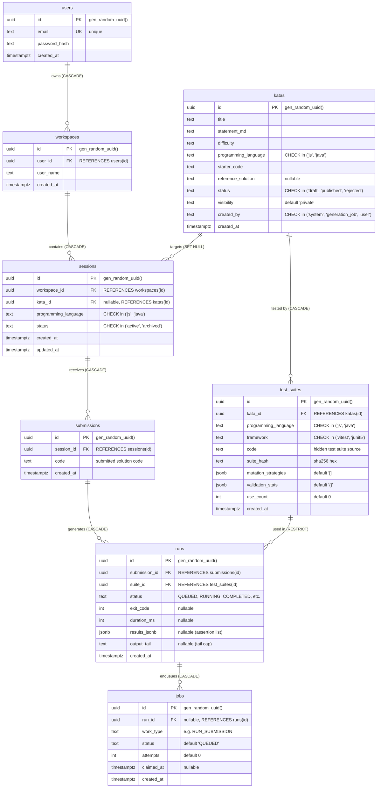

# CodePalace — PostgreSQL Entity-Relationship Diagram (V1)

This document reflects the active PostgreSQL database schema implemented in [`backend/src/main/resources/db/migration/V1__init.sql`](backend/src/main/resources/db/migration/V1__init.sql).

---

## Entity-Relationship Diagram



---

## Table Dictionary

### 1. `users`
Represents platform user accounts.
* `id` (`uuid`, PK): Defaults to `gen_random_uuid()`.
* `email` (`text`, UNIQUE, NOT NULL): User email address.
* `password_hash` (`text`, NOT NULL): Argon2 password hash.
* `created_at` (`timestamptz`, NOT NULL): Registration timestamp.

### 2. `workspaces`
Aggregate root for a user's projects and coding environment.
* `id` (`uuid`, PK): Defaults to `gen_random_uuid()`.
* `user_id` (`uuid`, FK, NOT NULL): References `users(id)` with `ON DELETE CASCADE`.
* `user_name` (`text`, NOT NULL): Workspace handle/name.
* `created_at` (`timestamptz`, NOT NULL): Creation timestamp.

### 3. `katas`
The catalog of coding challenges (system-seeded, AI-generated, or user-authored).
* `id` (`uuid`, PK): Defaults to `gen_random_uuid()`.
* `title` (`text`, NOT NULL): Short challenge title.
* `statement_md` (`text`, NOT NULL): Problem description in Markdown.
* `difficulty` (`text`, NOT NULL): e.g. `easy`, `medium`, `hard`.
* `programming_language` (`text`, NOT NULL): Restricted to `'js'` or `'java'`.
* `starter_code` (`text`, NOT NULL): Initial boilerplate presented in the editor.
* `reference_solution` (`text`, nullable): Validated baseline solution (for AI validation loops).
* `status` (`text`, NOT NULL): Restricted to `'draft'`, `'published'`, or `'rejected'`.
* `visibility` (`text`, NOT NULL): Defaults to `'private'`.
* `created_by` (`text`, NOT NULL): Restricted to `'system'`, `'generation_job'`, or `'user'`.
* `created_at` (`timestamptz`, NOT NULL): Creation timestamp.

### 4. `sessions`
An active or archived editor context within a workspace.
* `id` (`uuid`, PK): Defaults to `gen_random_uuid()`.
* `workspace_id` (`uuid`, FK, NOT NULL): References `workspaces(id)` with `ON DELETE CASCADE`.
* `kata_id` (`uuid`, FK, nullable): References `katas(id)` with `ON DELETE SET NULL`.
* `programming_language` (`text`, NOT NULL): Restricted to `'js'` or `'java'`.
* `status` (`text`, NOT NULL): Restricted to `'active'` or `'archived'`.
* `created_at` (`timestamptz`, NOT NULL): Initial creation timestamp.
* `updated_at` (`timestamptz`, NOT NULL): Last activity timestamp.

### 5. `test_suites`
Hidden test code used to evaluate kata solutions in sandbox containers.
* `id` (`uuid`, PK): Defaults to `gen_random_uuid()`.
* `kata_id` (`uuid`, FK, NOT NULL): References `katas(id)` with `ON DELETE CASCADE`.
* `programming_language` (`text`, NOT NULL): Restricted to `'js'` or `'java'`.
* `framework` (`text`, NOT NULL): Restricted to `'vitest'` or `'junit5'`.
* `code` (`text`, NOT NULL): Raw suite source code (subject to the [Hidden-Suite Privacy Invariant](docs/05-data-model-api.md#hidden-suite-privacy-invariant)).
* `suite_hash` (`text`, NOT NULL): SHA-256 hex fingerprint of `code`.
* `mutation_strategies` (`jsonb`, NOT NULL): Defaults to `'[]'::jsonb`.
* `validation_stats` (`jsonb`, NOT NULL): Defaults to `'{}'::jsonb`.
* `use_count` (`integer`, NOT NULL): Execution counter, defaults to `0`.
* `created_at` (`timestamptz`, NOT NULL): Creation timestamp.

### 6. `submissions`
Versioned snapshots of solution code submitted by a user.
* `id` (`uuid`, PK): Defaults to `gen_random_uuid()`.
* `session_id` (`uuid`, FK, NOT NULL): References `sessions(id)` with `ON DELETE CASCADE`.
* `code` (`text`, NOT NULL): Submitted code text.
* `created_at` (`timestamptz`, NOT NULL): Submission timestamp.

### 7. `runs`
Execution records tying a submission to a test suite and recording evaluation outcomes.
* `id` (`uuid`, PK): Defaults to `gen_random_uuid()`.
* `submission_id` (`uuid`, FK, NOT NULL): References `submissions(id)` with `ON DELETE CASCADE`.
* `suite_id` (`uuid`, FK, NOT NULL): References `test_suites(id)` with `RESTRICT`.
* `status` (`text`, NOT NULL): Defaults to `'QUEUED'`.
* `exit_code` (`integer`, nullable): Sandbox process exit code.
* `duration_ms` (`integer`, nullable): Total execution duration in milliseconds.
* `results_jsonb` (`jsonb`, nullable): Parsed test reporter output (passed/failed assertions, timings).
* `output_tail` (`text`, nullable): Tail-capped stdout/stderr buffer.
* `created_at` (`timestamptz`, NOT NULL): Creation timestamp.

### 8. `jobs`
The brokerless PostgreSQL queue table consumed by `exec-runner` via `LISTEN/NOTIFY jobs_channel`.
* `id` (`uuid`, PK): Defaults to `gen_random_uuid()`.
* `run_id` (`uuid`, FK, nullable): References `runs(id)` with `ON DELETE CASCADE`.
* `work_type` (`text`, NOT NULL): Work classification (e.g. `'RUN_SUBMISSION'`).
* `status` (`text`, NOT NULL): Defaults to `'QUEUED'`.
* `attempts` (`integer`, NOT NULL): Execution retry counter, defaults to `0`.
* `claimed_at` (`timestamptz`, nullable): Timestamp when a runner worker acquired the job.
* `created_at` (`timestamptz`, NOT NULL): Queue insertion timestamp.

---

## Foreign Key Cascades & Constraints

| Parent Table | Child Table | Foreign Key Column | On Delete Action | Notes |
|---|---|---|---|---|
| `users` | `workspaces` | `user_id` | `CASCADE` | Deleting an account cleans up all workspaces |
| `workspaces` | `sessions` | `workspace_id` | `CASCADE` | Deleting a workspace removes all contained sessions |
| `katas` | `sessions` | `kata_id` | `SET NULL` | Deleting a kata preserves session code history |
| `katas` | `test_suites` | `kata_id` | `CASCADE` | Deleting a kata removes its hidden test suites |
| `sessions` | `submissions` | `session_id` | `CASCADE` | Deleting a session purges submission history |
| `submissions` | `runs` | `submission_id` | `CASCADE` | Deleting a submission purges its run records |
| `test_suites` | `runs` | `suite_id` | `NO ACTION` (RESTRICT) | Prevents deleting test suites currently linked to run history |
| `runs` | `jobs` | `run_id` | `CASCADE` | Deleting a run cancels/cleans its queue job |

---

## Indexes & Optimizations

* `workspaces_user_id_idx` (`user_id`)
* `sessions_workspace_id_idx` (`workspace_id`)
* `sessions_kata_id_idx` (`kata_id`)
* `test_suites_kata_id_idx` (`kata_id`)
* `submissions_session_id_idx` (`session_id`)
* `runs_submission_id_idx` (`submission_id`)
* `runs_suite_id_idx` (`suite_id`)
* `jobs_run_id_idx` (`run_id`)
* **Partial Index:** `jobs_queued_idx` (`created_at`) `WHERE status = 'QUEUED'`
  * Specifically optimizes the `exec-runner` startup drain query:
    ```sql
    SELECT * FROM jobs WHERE status = 'QUEUED' ORDER BY created_at ASC;
    ```
