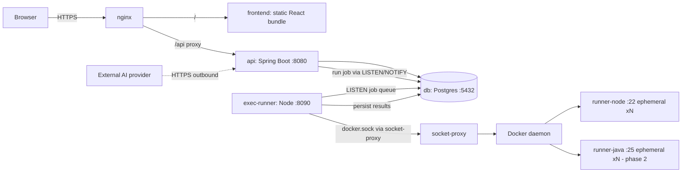
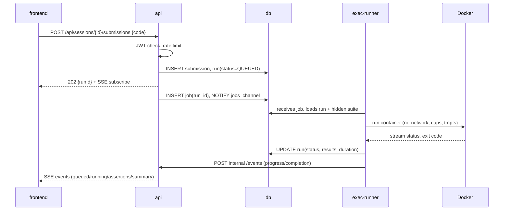
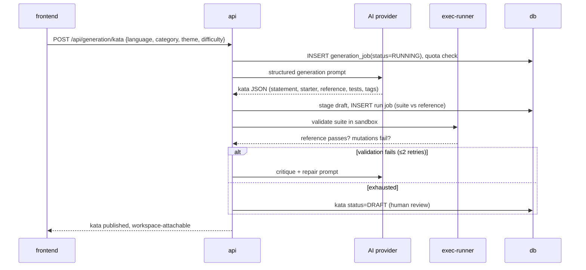
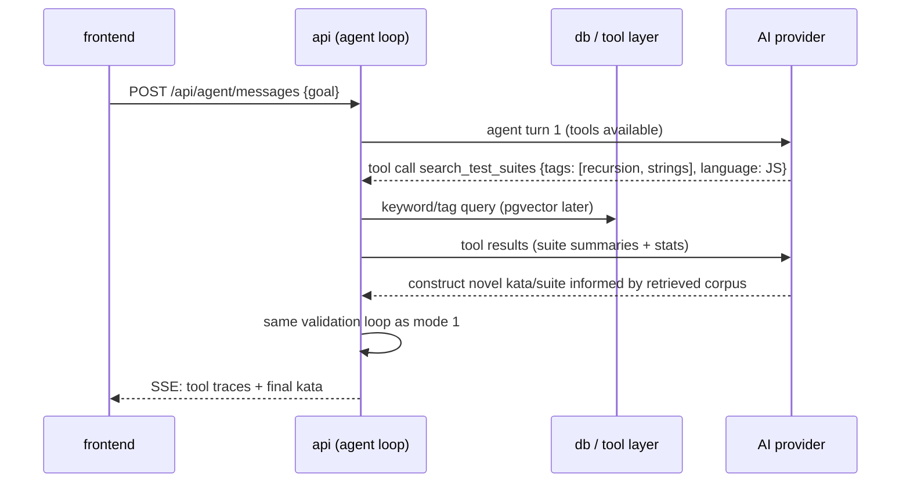

# 02 — Architecture

Services run on a single VM under docker compose. Names here are canonical across all docs.

## Service topology

| Service | Runtime | Responsibility |
|---|---|---|
| `nginx` | nginx | TLS termination, static files, `/api` reverse proxy |
| `frontend` | nginx + static React (Vite) | Monaco editor, workspace shell, SSE consumption |
| `api` | Spring Boot (Java 25) | Auth, domain CRUD, job enqueue, AI orchestration, SSE hub |
| `exec-runner` | Node | Spawn/cap/torn-down ephemeral exec containers, stream run events |
| `db` | Postgres 16 | Domain data, job queue (`LISTEN/NOTIFY`), run results |
| `socket-proxy` | tecnativa/docker-socket-proxy | Expose only `POST /containers/create`, `POST /containers/start`, `DELETE /containers`, `GET /containers/json` to `exec-runner` |

**No Redis/RabbitMQ on purpose.** The run-job bus is a Postgres table + `LISTEN/NOTIFY`: one row per job, `exec-runner` keeps a `LISTEN jobs_channel` connection. One VM, one runner → a broker is accidental complexity (documented for future scaling in [03-execution-sandbox.md](03-execution-sandbox.md#scaling-notes-future)).

## Flow 1 — Run a submission (M1)

## Flow 2 — Generate a kata, mode 1 (M2)

## Flow 3 — Agent retrieval + construction, mode 2 (M4)

## Key invariants

1. **Hidden suites never cross the api boundary to the client.** Suites travel only: `db → exec-runner → container`. See [05-data-model-api.md](05-data-model-api.md#hidden-suite-privacy-invariant).
2. **All code execution happens in ephemeral containers.** `api` never evals/compiles user code in-process.
3. **AI is behind an interface**, so M4 mode 2 and provider swaps do not fork the codebase ([04-ai-and-retrieval.md](04-ai-and-retrieval.md)).
4. **Job queue survives restarts** (rows in Postgres, re-`NOTIFY`ed on runner boot with `status=QUEUED` scan).
