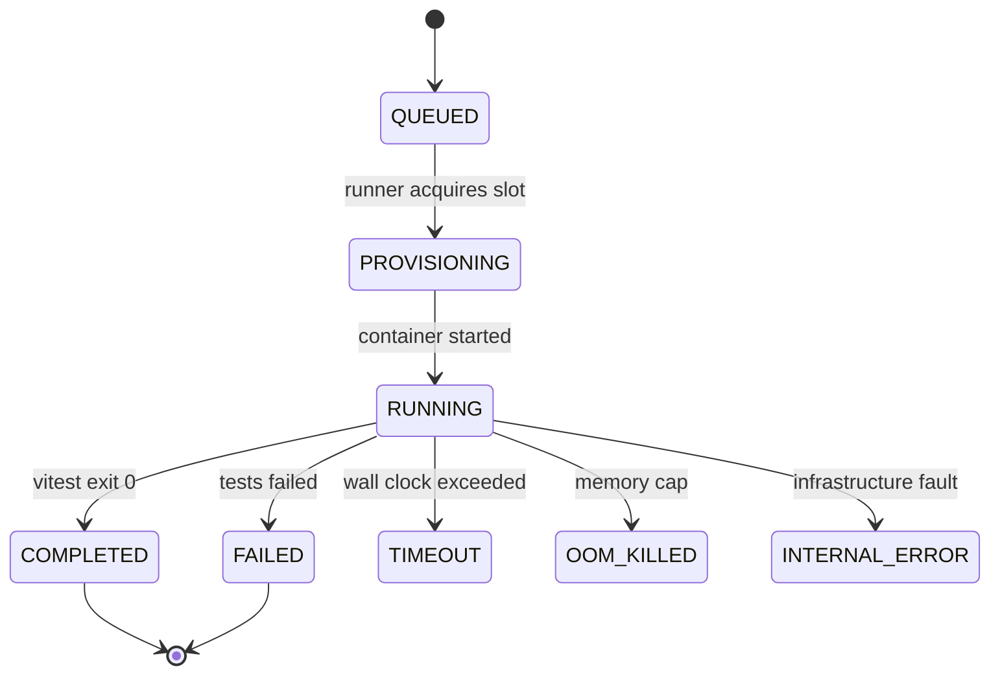

# 03 — Execution Sandbox

The single riskiest component: CodePalace runs untrusted user code by design. This doc is the contract for how that is done safely on a single VM.

## Threat model

| Threat | Vector | Mitigation |
|---|---|---|
| Sandbox escape → host compromise | Java/JS runtime 0-days, kernel paths | Ephemeral containers, read-only rootfs, non-root user in image, socket-proxy restricts Docker API verbs; audits: image pinning by digest |
| Network exfiltration / attack relay | outbound sockets from run code | `--network none` always; network access is *never* configurable |
| Resource exhaustion / DoS | infinite loops, fork bombs, giant allocations | CPU/mem/pids caps + wall-clock kill, per-user submission rate limits at `api` |
| Persistence between runs | malware surviving in the box | Fresh container per run; volume-less tmpfs; runner teardown on exit *and* timeout |
| Secret theft | env vars, docker socket, DB creds | Nothing user-relevant inside the run container. Only `code + tests`; egress none; socket proxy exposes no `exec`, no volume write |
| Hidden-suite theft | user imports/tests visibility | Suites are streamed into the container at run time only; users see results, never code ([privacy invariant](05-data-model-api.md#hidden-suite-privacy-invariant)) |
| Runner compromise (e.g. malicious payload via path traversal job id) | API ↔ runner messages | Internal-only network range in compose, message schema validated, no shell-out with interpolated strings |

**Residual risk is accepted and documented:** containers are not Firecracker/gVisor-grade. Accepted because: single-VM demo scope, no PII beyond email/hashes on the box, inbound attack surface is only nginx + `/api`.

## Runner images

| Image | Base | Contents | Owner |
|---|---|---|---|
| `codepalace/runner-node:22` | `node:22-alpine` (pinned by digest) | `vitest` 5.0.5 pinned (local install), non-root `kata` user, `/sandbox` workdir, `vitest.config.mjs` (JSON reporter to stdout, caches in `/tmp`), entrypoint `vitest run --configLoader=runner` | built by CI from `sandbox-images/node/` |
| `codepalace/runner-java:25` (M4) | `eclipse-temurin:25-jre-alpine` | JUnit 5 console launcher prewarmed; dependencies vendored at image build | built from `sandbox-images/java/` |

Images are built once and pinned by digest on the VM — user runs never `docker build`.

Resource budgets (initial): Node gets `256MB / 1.0 CPU / 10s wall clock`; Java target is `512MB / 30s`, revisited with measurement data at M4.

### Decision: writable root filesystem (no `--read-only`)

Docker's archive API (`PUT /containers/{id}/archive`) rejects uploads to any container with a read-only rootfs (`400 container rootfs is marked read-only`), including into tmpfs paths. We therefore run with a writable root and compensate:

- Non-root `kata` (UID 10001), `--cap-drop ALL`, `no-new-privileges`, no network.
- Everything under `/sandbox` except `tmp/` and `.vitest/` is **root-owned and not writable by `kata`**: uploaded code and suite (0444), `node_modules/vitest`, and `vitest.config.mjs`. User code cannot rewrite the suite or patch vitest on disk.
- Writable scratch is limited to `/tmp`, `/var/tmp`, `/home/kata`, `/sandbox/tmp` and `/sandbox/.vitest`, all size-capped tmpfs (`noexec,nosuid`, 16–64MB). These are the only places `kata` has write permission, so the container's writable layer can't be filled. Docker's `StorageOpt` quota is **not** used: the overlayfs/containerd driver accepts it but doesn't enforce it. If a new image adds `kata`-writable paths, add a tmpfs for them (`runner/limits-check.js` will catch it).
- Verified by `runner/security-check.js` (probe suite run inside the real sandbox config) and `runner/limits-check.js` (resource limits and disk fill).

Residual risks: user code runs in the vitest process, so in-memory monkeypatching of `expect` and printing forged JSON are still possible. Treat results as produced by untrusted code. Alternatives to revisit when hardening: upload into a volume mounted read-only (needs socket-proxy `VOLUMES=1`), or pipe the tar over stdin into a tmpfs.

## Run lifecycle (state machine)

```
QUEUED → PROVISIONING → RUNNING → COMPLETED
                     ↘ FAILED (tests failed)          ↘ TIMEOUT (wall clock) → torn down
                     ↘ INTERNAL_ERROR (runner/bus)     ↘ OOM_CONTAIN (Docker event)
```

`exec-runner` duties per run:

1. Acquire slot from local semaphore (**max 3 concurrent containers** — VM budget, see [06-devops.md](06-devops.md#vm-sizing)).
2. Create container (stopped): `--network none --cap-drop ALL --security-opt no-new-privileges --memory 256m --cpus 1.0 --pids-limit 128 --workdir /sandbox --tmpfs /tmp:noexec,nosuid,size=64m --tmpfs /sandbox/tmp:noexec,nosuid,size=32m`. Code + suite are uploaded via the Docker archive API as a root-owned, mode 0444 tar (`src/`, `tests/`), then stdout/stderr is captured (tail-capped 64KB). Memory/CPU/PID caps land in build-path Phase 1 Step 3.
3. `docker start`, follow events; enforce wall clock with `docker kill` fallback.
4. Parse vitest JSON; emit run events; persist results row.
5. `docker rm -f` in all paths (finally block), release slot.

## Result streaming & persistence

- `exec-runner` → `api`: internal `POST /internal/run-events` (compose-internal network only).
- `api` → browser: **SSE** on `/api/runs/{id}/events`: `queued`, `provisioning`, `running`, `assertion` (incremental), `summary` (final: passed/failed counts, durations, first diff), `error`.
- Final results JSON stored on `runs.results_jsonb` (assertion list, timings, suite hash actually used).
- Console output is a *tail* only — full logs are not a feature.



## Sandbox content layout (per run, tmpfs scratch)

```
/sandbox
├── src/            # user code (submitted)
├── tests/          # hidden suite (mounted at run time, deleted on teardown)
└── tmp/
```

Player code is imported by the suite; the suite is deleted post-run.

## JVM notes (M4)

- **Cold start is ~1–2s JVM boot** — acceptable inside a 30s cap for M4.
- **Warm pool is a v2 lever**, not M4 scope: keep N prestarted containers paused; runner punch-through with code injection. Only if measurements demand it.
- Alternative noted but rejected for v1: GraalVM native-image runners (complexity + reflection config for JUnit).

## Scaling notes (future)

Current single-runner, single-VM: queue on Postgres, semaphore local. Horizontal path: multiple `exec-runner` instances on different VMs, same Postgres `LISTEN/NOTIFY`, per-VM slot cap. Documented so M1 bus design does not prevent it.
