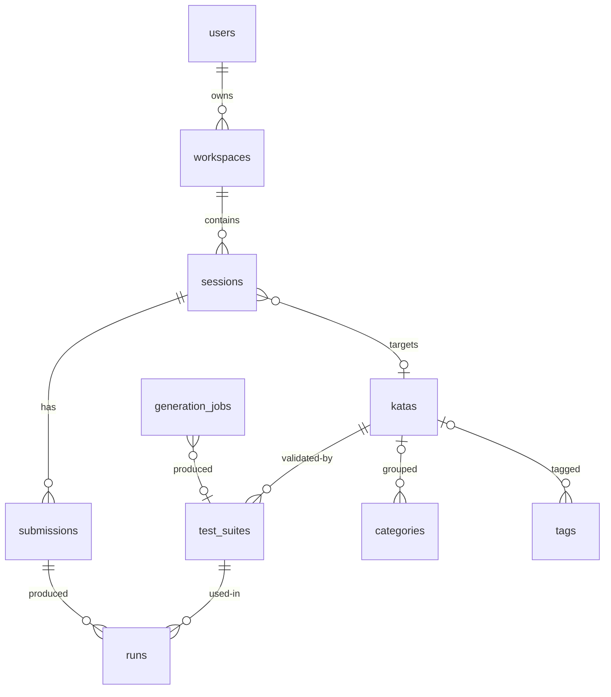

# 05 — Data Model & API

Postgres-backed. Aggregate root is the **Workspace** ([roadmap decision](01-vision-and-roadmap.md#deliberate-push-backs-encoded-here)).

## ER model



## Tables

| Table | Key columns | Notes |
|---|---|---|
| `users` | id uuid pk, email unique, password_hash (Argon2), created_at | |
| `workspaces` | id, user_id fk, name, created_at | Multiple per user; UI starts with one default |
| `sessions` | id, workspace_id fk, kata_id fk nullable, language js/java, status active/archived, updated_at | Session = one kata attempt context in MVP; many per workspace later |
| `katas` | id, title, statement_md, difficulty, language, starter_code, reference_solution, category_id fk, status (draft/published/rejected), visibility, created_by (system/generation_job/user), created_at | `published` = validated; `draft` = failed validation or human review |
| `kata_tags` | kata_id, tag_id | plus `tags(id, slug, name)` |
| `categories` | id, slug, name, description | e.g. recursion, dynamic-programming, string-parsing |
| `test_suites` | id, kata_id fk, language, framework (vitest/junit5), code, suite_hash, mutation_strategies jsonb, validation_stats jsonb, use_count, created_at | see privacy invariant below |
| `submissions` | id, session_id, code, created_at | autosave writes here on PATCH, history naturally versions |
| `runs` | id, submission_id, suite_id, status, exit_code, duration_ms, results_jsonb, output_tail, created_at | state machine in [03](03-execution-sandbox.md#run-lifecycle-state-machine) |
| `jobs` | id, run_id nullable, gen_job_id nullable, type, status, attempts, claimed_at, created_at | Postgres bus: `LISTEN/NOTIFY jobs_channel` [02](02-architecture.md) |
| `generation_jobs` | id, mode (ui_pick/agent), requested_by, params jsonb, tokens_in/out, cost_estimate, provider, status, created_at | provider-agnostic ledger |

Phase 2 (M4): `kata_embeddings(kata_id, embedding vector(1536), model)`.

## Hidden-suite privacy invariant

> Hidden test suites leave the database exactly twice: once into an exec container's tmpfs at run time, once into a validation sandbox. They are never returned by an API response that a browser can call, never serialized into session state the client sees, and excluded from all domain DTOs by construction (mapper layer omits the field, no `code` column in public projections).

Enforcement: repository methods return `SuiteRef` metadata without `code`; the only `code` readers are `exec-runner` job assembly and the validation loop.

## API surface (draft)

Auth [07-frontend.md](07-frontend.md) stores JWT; all non-auth routes require `Authorization: Bearer`.

| Method | Path | Purpose |
|---|---|---|
| POST | `/api/auth/register` / `/api/auth/login` | Argon2, issue JWT (24h) |
| GET/POST/DELETE | `/api/workspaces` / `/{id}` | workspace CRUD |
| POST | `/api/workspaces/{wId}/sessions` | nullable `kataId` → editor-first or kata-first |
| PATCH | `/api/sessions/{id}` | rename/archive; `kataId` attach |
| PUT | `/api/sessions/{id}/draft` | autosave (debounced client, [07](07-frontend.md)) |
| POST | `/api/sessions/{id}/submissions` | body; returns `202 {runId}` |
| GET | `/api/runs/{id}` | latest run state |
| GET | `/api/runs/{id}/events` | SSE: queued→running→assertions→summary ([03](03-execution-sandbox.md#result-streaming--persistence)) |
| GET | `/api/categories` | taxonomy snapshot for picker |
| GET/POST | `/api/generation/kata` | mode 1 trigger + status; body `{language, category, theme, difficulty}` |
| GET | `/api/katas?query=&tag=&category=&difficulty=` | corpus browse (UI pick + [agent search reuse](04-ai-and-retrieval.md#retrieval-design)) |
| POST/GET | `/api/agent/messages` / `/api/agent/sessions` (M4) | agent chat; SSE incl. tool traces |

## SSE event envelope

```json
{"event": "assertion", "data": {"name": "palindrome('racecar')", "passed": true, "ms": 0.4, "diff": null}}
```

Diffs only for failures; truncated payload policy lives in [03](03-execution-sandbox.md).
