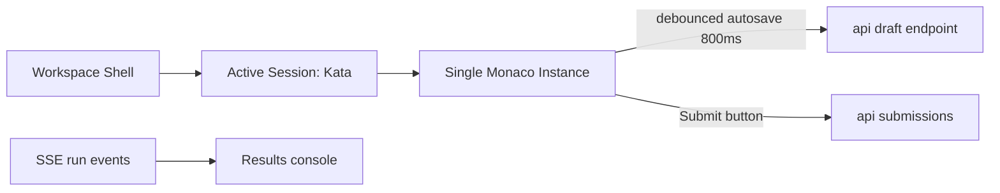

# 07 — Frontend

React + Vite + Tailwind. Editor: **Monaco**. Analysis below; this is the [locked stack](../README.md#scope-decisions-locked) recommendation encoded.

## Monaco vs CodeMirror (decision: Monaco)

| Criterion | Monaco | CodeMirror 6 |
|---|---|---|
| Editor feel for Java/JS | VS Code-grade, full syntax + basic IntelliSense both | excellent, lighter weight |
| Diff view (kata reference diffing later) | built-in `createDiffEditor` | manual |
| React integration | `@monaco-editor/react` mature | solid |
| Bundle size | ~1.5-2MB loaded async | 300-500KB |
| Multi-file tabs + workspace polish (M4) | matches VS Code look — the product *is* a mini-IDE | cleaner minimal look |

Monaco's weight cost is irrelevant here (kata workspaces are heavy-use, not mobile-first), and the diff editor + IDE-shaped UI directly serve M4. Verdict: Monaco.

## Screens

| Screen | Contents | Ships |
|---|---|---|
| Login / Register | email + password forms | M1 |
| Workspaces | grid of user workspaces | M1 |
| Workspace shell | left: kata description & session list; center: **single active Monaco editor**; right/bottom: console results & run history | M1 (single-file editor) |
| Generation picker | language/category/theme/difficulty modal | M2 |
| Agent chat | full width, tool traces inline | M4 |

## State & data flow

- **TanStack Query** for all REST (workspaces, sessions, katas, runs).
- **SSE** (`EventSource`) per active run: reuses native reconnect; events per [API](05-data-model-api.md#sse-event-envelope): optimistic console assertions as they land.
- **Zustand** only for ephemeral editor state (active tab, terminal state); persistence stays server-authoritative.
- **Autosave:** debounced `PUT /sessions/{id}/draft` at 800ms idle + on blur; editor value hydrated from last submission *or* draft on load.
- **Auth:** JWT in memory + silent-refresh attempt on 401 → redirect login; no cookies/local storage of tokens longer than the session.

## Single-File Editor UX (Locked Simplification)

Rather than emulating a multi-file IDE with tabs and a file tree, CodePalace adopts a **LeetCode / Codewars-style single-file editor per kata**:

- **One editor instance per active session:** Mounts the session's code (e.g. `solution.js`) directly.
- **Zero multi-tab complexity:** Switching to a different kata simply re-hydrates the single editor with that kata's code. This eliminates multi-model memory leaks and tab-state synchronization headaches in React.
- **Undo stack:** Handled natively by the Monaco instance for the currently active kata.

## Results console UX

- Assertion list rows: name, status icon, duration; failed rows expandable to diff.
- **Users never see suite code** — consistent with the [privacy invariant](05-data-model-api.md#hidden-suite-privacy-invariant).
- Timeout / OOM states have distinct, named messages ([03](03-execution-sandbox.md#run-lifecycle-state-machine)) — a timeout is never "compilation error".

## Later phases

M4 multi-file tabs and file tree ride on the M1 schema (sessions already host multiple submissions; kata files arrive as a `kata_files` extension if workspace productization demands it, but editor tabs stay session-local in v1).
